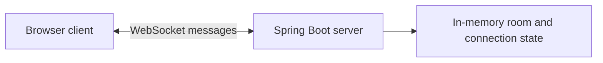

# ChatConnect

ChatConnect is a small, temporary two-person chat application. The Java/Spring Boot server hosts the browser interface and relays live messages. There are no accounts and no saved message history.

## How the chat will work

- One person creates a private room and shares its short code with the other person.
- Each person enters a display name and joins that room.
- A room accepts exactly two connected people.
- Messages are relayed live over WebSocket and are not saved to a database or server-side log.
- If someone joins after messages were sent, they do not receive earlier messages. Closing the browser or disconnecting clears that person's server-side room state.
- The messages visible in the open browser tab are temporary conversation context. They disappear when the page is closed or reloaded.

Display names and room codes are for connecting people, not identity verification. Anyone with a room code may try to join while a place is open, so share it only with the intended person.

## Architecture



The server keeps only the active room membership needed to relay messages. It does not write messages or user accounts to disk. Server shutdown clears all active rooms. The app is intended for local learning; a room code is an invitation, not strong authentication.

## Current implementation

The app has a Spring Boot backend, in-memory two-person rooms, live WebSocket message relay, and a responsive browser interface. Rooms support a display name, six-character invite code, copy button, connection state, and one-to-one messages.

## Planned stages

1. Confirm the temporary, no-login, two-person design (complete).
2. Set up the Java backend and WebSocket dependencies (complete).
3. Implement room creation, joining, disconnect handling, and live message relay in memory (complete).
4. Add the browser interface for creating/joining a room and chatting (complete).
5. Run the backend and two browser clients locally to verify two-way communication.

## Run the backend

Prerequisites: JDK 25 or newer and Maven 3.6.3 or newer. MySQL is not needed.

Double-click `Start ChatConnect.bat`, or from PowerShell run `Start ChatConnect.ps1`. The launcher looks for Maven on PATH or in the standard local Maven-wrapper cache. You can also start it manually from `ChatConnect/backend`:

```powershell
mvn spring-boot:run
```

Open `http://localhost:8080` after the server reports that it started. Open the same address in two browser tabs (or on two computers on the same network), create a room in one, and join with its code in the other. For a second computer, use the host computer's local network IP address instead of `localhost` and make sure Windows Firewall allows the connection.

No MySQL installation, Maven command on PATH, account, or environment file is required by the launcher. A JDK 25+ is required. The first Maven run may download dependencies from Maven Central.

## Deploy for friends

The project includes a `Dockerfile` for a single-instance Render Web Service. The app binds to Render's `PORT`, serves the interface over HTTPS, and accepts WebSocket upgrades through the service URL.

1. Create a GitHub repository and publish the contents of this `ChatConnect` folder to it. Do not include `backend/target`; it is generated build output and is ignored by Git.
2. In Render, create a **Web Service** and connect that repository. Render detects the root `Dockerfile`; select the Free plan for a demo if it is available to your account.
3. Keep the service at one instance. Active rooms exist only in that server's memory and disappear when it restarts or redeploys.
4. After deployment succeeds, open the generated `onrender.com` address and test with two browser sessions. Share that public address and a room code with your friend.

Free Render services can spin down after 15 minutes without inbound traffic and may take about a minute to wake up. For a classroom or portfolio demo, this is usually acceptable; it is not configured as a production service. Do not send sensitive messages in this no-login demo.
